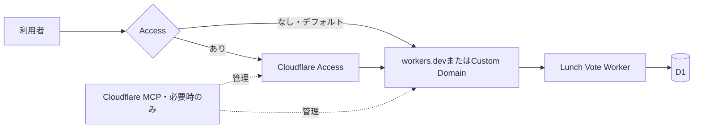

# Lunch Vote

[](https://deploy.workers.cloudflare.com/?url=https://github.com/ts-76/internal-app)

Cloudflare Workers、Vite、React Router SSR、Hono、Tailwind CSS、D1で動く、社内向けの
ランチ候補・投票Webアプリです。候補の追加と一票ずつの投票ができ、得票順に
並べて次のランチを決められます。Honoを最上位ルーターとして、画面はReact RouterからSSRし、
GitHubの`main`をWorkers Buildsから継続的にデプロイします。

## Deploy to Cloudflareで使い始める

上のボタンからGitHubへリポジトリを複製し、CloudflareアカウントとWorker名を選んで
デプロイします。D1 databaseはセットアップ中に作成され、migrationも初回デプロイ時に
適用されます。

初期構成ではCustom DomainとCloudflare Accessを使いません。Workerは
`<worker-name>.<account-subdomain>.workers.dev`で公開されます。

## ローカルで確認する

Node.js 24.18以上25未満、npm 11以上、mise、Gitを使います。`mise install`を実行すると、
Cloudflare Workers Buildsと同じNode.js 24.18.0と、同梱のnpm 11.16.0が入ります。

```sh
mise install
mise exec -- npm ci
mise exec -- npm exec -- wrangler d1 migrations apply DB --local
mise exec -- npm run dev
```

起動後に画面とAPIを確認します。

```sh
open http://localhost:5173/app
curl -i http://localhost:5173/health
curl -i http://localhost:5173/app/api/lunch-options
```

`npm run dev`はCloudflare Viteプラグインを使い、Workerを本番と同じ`workerd`で動かしながら、
React画面のHMRを提供します。Honoが全リクエストを受け、`/app*`だけReact RouterのSSRへ
委譲します。初回表示はSSR、ハイドレーション後の画面遷移はクライアント側で行われます。
production buildとローカルpreviewは次で確認できます。

```sh
mise exec -- npm run build
mise exec -- npm run preview
```

サンプルデータが必要な場合は、別のターミナルからローカルD1へ追加します。

```sh
mise exec -- npm exec -- wrangler d1 execute DB --local --command "INSERT OR REPLACE INTO lunch_options (id, name, suggested_by, votes) VALUES ('local-sample', '駅前のスパイスカレー', 'トマ', 3)"
```

## 公開方法は4通りから選べる

デフォルトは`workers.dev`で直接公開します。Custom DomainとAccessは、必要になった時点で
`config/cloudflare/production.json`へ設定を追加し、Cloudflare MCPから反映します。



| Custom Domain | Access | 公開方法                      |
| ------------- | ------ | ----------------------------- |
| なし          | なし   | `workers.dev`で直接公開       |
| なし          | あり   | Accessで保護した`workers.dev` |
| あり          | なし   | Custom Domainで直接公開       |
| あり          | あり   | Accessで保護したCustom Domain |

Custom Domainを追加する場合は、Cloudflare Account IDとdomain設定を追加します。

```jsonc
{
  "projectId": "lunch-vote",
  "accountId": "<CLOUDFLARE_ACCOUNT_ID>",
  "environment": "production",
  "app": {
    "id": "lunch-vote",
  },
  "customDomain": {
    "baseDomain": "example.com",
    "hostname": "lunch-vote.example.com",
  },
}
```

Accessも使う場合は、`access`設定と許可ユーザーCSVを追加します。Custom Domainを使わず
`workers.dev`を保護する場合は、`app.workersDevHostname`も指定してください。

```sh
cp config/access/production.example.csv config/access/production.csv
```

```jsonc
"access": {
  "authDomain": "your-team.cloudflareaccess.com",
  "path": "/app",
  "resourceNames": {
    "identityProvider": "lunch-vote-email-one-time-pin",
    "emailList": "lunch-vote-lunch-vote-emails",
    "application": "lunch-vote-lunch-vote",
    "policy": "lunch-vote-lunch-vote-allow"
  }
}
```

`access.path`はAccess Applicationの保護範囲です。このアプリでは`/app`を指定し、内部画面と
`/app/api/*`を保護します。

## URLと認証の境界

| URL                      | 処理                         | 認証                          |
| ------------------------ | ---------------------------- | ----------------------------- |
| `/`                      | Honoから`/app`へredirect     | redirect先でCloudflare Access |
| `/app`、`/app/*`         | React Router SSR・client遷移 | Cloudflare Access             |
| `/app/api/lunch-options` | Hono API                     | Cloudflare Access             |
| `/health`                | Hono health endpoint         | なし                          |

短期公開URL、期限、利用回数制限、QRコードが必要になった場合は、アプリ標準構成へ先回りで
依存を追加せず、AIエージェントへ要件を伝えてください。プロジェクトの`hono-door` Skillが、
core packageだけを使う構成と任意の管理UIを含む構成を案内します。

`resourceNames`は省略でき、`projectId`と`app.id`から生成されます。既存resourceをMCP管理へ
移行する場合は、誤って同名に近いresourceを新規作成しないよう、現在の名前を明示してください。

リモート設定はCloudflare MCPで現在値を確認し、差分の承認後に反映します。詳しい作業規則は
`AGENTS.md`を参照してください。

## mainの更新を自動デプロイする

Deploy to Cloudflareは、複製したリポジトリとWorkers Buildsを接続します。`main`が更新されると、
品質チェックの後、デプロイスクリプトがVite production build、D1 migration、Workerデプロイの
順に実行します。ローカルやGitHub Actionsから本番へ直接デプロイする構成は使いません。

## 構成

- `app`: React Router routes、SSR entry、Tailwind CSS
- `src/hono-app.ts`: Hono最上位ルーターとReact Routerへの振り分け
- `src/routes`: ランチ候補用のHono APIとhealth endpoint
- `src/services`: ランチ候補と投票をD1へ保存するサーバー側サービス
- `src/style.css`: Tailwind CSSのテーマと共通スタイル
- `migrations`: D1 migration
- `wrangler.jsonc`: WorkerとD1 binding
- `vite.config.ts`: Cloudflare Workers、React Router SSR、Tailwind CSS、Vite+品質チェックの設定
- `config/cloudflare/production.json`: 任意インフラの設定
- `.agents/skills/hono-door`: 短期公開リンクを追加・運用するときの公式Skill
- `scripts`: Workers Buildsと設定検証の安全な実行入口

## 変更を検証する

```sh
mise exec -- npm run check
mise exec -- npm run infra:check
```

`npm run check`はformat、lint、型チェック、secretlint、testをまとめて実行します。
`infra:check`はCloudflareへ接続せず、Custom DomainとAccessの設定とMCP反映順序を検証します。
リモートとの差分確認と反映は、現在の会話で依頼された場合だけCloudflare MCPから行います。

依存関係のインストールでは、`.npmrc`により公開後7日未満のパッケージと依存パッケージの
install scriptを拒否します。必要な処理は`npm run`から明示的に実行してください。
