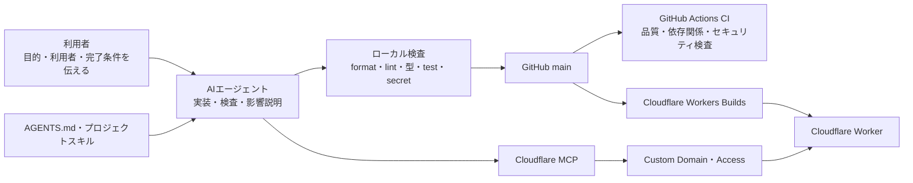

# AIとつくるCloudflare Webアプリのスターター

[](https://deploy.workers.cloudflare.com/?url=https://github.com/ts-76/internal-app)

このリポジトリは、非エンジニアとAIエージェントが共同でWebアプリをつくり、安全かつ簡単に
Cloudflareへ公開するためのサンプル基盤です。完成済みの製品を提供することが目的ではありません。

現在入っているランチ投票アプリは、画面、API、データベース、認証、デプロイが一通り動くことを
確認するためのサンプルです。アプリの題材や機能自体には意味を持たせていないため、実際に使う
ときは目的に合った内容へ置き換えてください。

初めて触る場合は「このプロジェクトで実現したいこと」「人とAIの役割」「使い始める」の3章を
読めば作業を始められます。それ以降は、設定を変えたいときに必要な章だけ参照してください。

## このプロジェクトで実現したいこと

利用者は、つくりたいアプリ、使う人、必要な機能を自然な言葉でAIエージェントへ伝えます。
AIエージェントは、プロジェクトルールとスキルを参照しながら、実装、検査、デプロイ準備を進めます。

この分担によって、利用者がコードやCloudflareの細かな設定方法を覚えていなくても、次の状態を
目指せます。

- 要望を会話で伝え、動くWebアプリへ変えられる
- 変更内容と本番への影響を確認してから公開できる
- 認証や公開範囲をCloudflare MCP経由で設定できる
- 秘密情報、データ消失、依存パッケージのリスクを共通ルールで抑えられる
- CodexとClaude Codeのどちらでも同じプロジェクトスキルを参照できる



## 人が決め、AIエージェントが具体化する

利用者が決めるのは、技術ではなくアプリの目的です。依頼するときは、分かる範囲で次の4点を
伝えてください。

1. 何を変えたいか
2. 誰が使うか
3. 本番へ公開したいか
4. 何を確認できたら完了か

ファイル名、ライブラリ名、Cloudflareの設定項目まで指定する必要はありません。AIエージェントが
コードとルールを確認し、不足している判断だけを質問します。

通常の共同作業は次の順番です。

1. 利用者が要望を伝える
2. AIエージェントが現在のコードと`AGENTS.md`を確認する
3. AIエージェントが実装し、ローカル検査を実行する
4. 変更内容、本番への影響、確認方法、未解決事項を利用者へ報告する
5. 利用者が本番反映を依頼した場合だけ、AIエージェントが`main`へpushする
6. Cloudflare設定が必要な場合は、MCPで現在値と差分を確認してから反映する

## 安全策はプロジェクトに組み込んである

| リスク                           | このプロジェクトでの扱い                                                 |
| -------------------------------- | ------------------------------------------------------------------------ |
| 意図しない本番デプロイ           | `main`へのpush前に影響を伝え、Workers Buildsだけが本番へデプロイする     |
| Access設定の重複や誤変更         | Git上の希望状態とMCPで取得した現在値を比較し、承認された差分だけ反映する |
| 秘密情報の漏えい                 | `.env`やAPIトークンを会話、ログ、Issue、commitへ記載しない               |
| D1のデータ消失                   | テーブルや列の削除は通常変更と分け、影響と復旧方法を確認してから実行する |
| 依存パッケージ経由の攻撃         | 公開後7日未満のpackageとinstall scriptをnpm設定で拒否する                |
| Access設定前の検索流入           | 初期状態では検索登録とクローラー巡回を拒否する                           |
| AIエージェントごとの手順の違い   | `AGENTS.md`を正本とし、CodexとClaude Codeから共通スキルを参照する        |
| 検査されていないコードの見落とし | ローカル検査に加え、GitHub ActionsのCIでも品質とセキュリティを確認する   |
| 壊れたコードのデプロイ           | Workers Buildsでも検査し、失敗した場合はWorkerを更新しない               |

詳しい作業規則は`AGENTS.md`にあります。`CLAUDE.md`は同じ正本への案内だけを持ちます。

## 使い始める

### GitHubとCloudflareへ複製する

冒頭の「Deploy to Cloudflare」ボタンからリポジトリを複製し、CloudflareアカウントとWorker名を
選びます。Workers BuildsがGitHubの`main`を監視し、品質検査、D1 migration、Workerの更新を
順番に実行します。

複製後は、AIエージェントへ「このアプリを○○用に変更したい」と伝えてください。ランチ投票の
画面やデータ構造を残す必要はありません。

### ローカルで確認する

Node.js 24.18以上25未満、npm 11以上、Gitを使います。

```sh
npm ci
npm exec -- wrangler d1 migrations apply DB --local
npm run dev
```

ブラウザーで`http://localhost:5173/app`を開くと、現在のサンプルアプリを確認できます。
コマンド操作を避けたい場合は、AIエージェントへ「開発サーバーを起動して、確認用URLを開いて」
と依頼してください。

## 実際のアプリへ変更する場所

利用者は「画面を変えたい」「保存項目を増やしたい」のように要望を伝えれば十分です。AIエージェントは
主に次の場所を変更します。

| 変えたいもの                      | 主な変更場所                                      |
| --------------------------------- | ------------------------------------------------- |
| 画面、文言、操作、見た目          | `app/routes`、`app/root.tsx`、`app/app.css`       |
| APIやサーバー側の処理             | `src/routes`、`src/services`                      |
| D1へ保存するデータの構造          | `migrations`                                      |
| WorkerとD1などの接続              | `wrangler.jsonc`                                  |
| Custom DomainとAccessの希望状態   | `config/cloudflare/production.json`               |
| Accessを許可するメールアドレス    | `config/access/production.csv`                    |
| AIエージェントの共通ルール        | `AGENTS.md`                                       |
| CodexとClaude Codeが参照するSkill | `.agents/skills`と`.claude/skills`のsymbolic link |

`.react-router`、`build`、`.wrangler`、`worker-configuration.d.ts`は生成物です。直接編集せず、
元のコードや設定を変更してから生成コマンドを実行します。

## 標準構成はひとつのWorkerにまとめる

標準構成は、Cloudflare Workers、Hono、React Router、Vite、Tailwind CSS、D1です。ひとつのWorkerで
APIとWeb画面を扱うため、小さな業務アプリを別々のサーバーへ分けずに運用できます。

- HonoがすべてのHTTPリクエストを受ける
- `/app`配下の画面はReact RouterがSSRし、読み込み後はSPAとして遷移する
- `/app/api`配下のAPIはHonoが処理する
- D1がアプリのデータを保存する
- Tailwind CSSが画面のスタイルを管理する

この構成は固定ではありません。アプリの目的に合わない場合は、理由と移行時の影響を確認したうえで
AIエージェントへ変更を依頼できます。

## 公開範囲と認証は必要になった時点で決める

公開先は、`workers.dev`またはCustom Domainから選べます。社内限定や特定メンバー限定にする場合は、
Cloudflare Accessを追加します。

初期状態ではCustom DomainとAccessを設定していません。希望状態は
`config/cloudflare/production.json`を正本とし、Accessを有効にする場合は
`config/access/production.example.csv`から`config/access/production.csv`を作成して許可対象を
記載します。リモート設定の確認と反映にはCloudflare MCPだけを使い、Terraform、REST API、
Wranglerへ切り替えません。

初回デプロイ直後に検索結果へ登録されないよう、`ALLOW_INDEXING`の初期値は`false`です。この状態では
すべてのWorker応答に`X-Robots-Tag`を付け、`robots.txt`でもクローラーの巡回を拒否します。
これらは検索エンジンへの指示であり、画面へのアクセス自体は防ぎません。非公開情報を扱う場合は、
検索設定に頼らずCloudflare Accessを設定してください。

一般公開する段階になったら、`wrangler.jsonc`の`ALLOW_INDEXING`を`true`へ変更し、型生成と検査を
実行してからデプロイします。

```sh
npm run typegen
npm run check
```

AIエージェントへ「この画面を社内メンバーだけに公開したい」と伝えると、MCPから現在値を読み、
Git上の希望状態との差分を提示します。追加や更新は差分の承認後に実行し、削除、Accessの無効化、
設定の切り離しは分けて確認します。

期限付きURL、利用回数制限、QRコードが必要な場合は、AIエージェントへ短期リンクが必要だと
伝えてください。標準構成へ機能を先回りで追加せず、プロジェクトの`hono-door` Skillを使うか
要件を確認してから決めます。

## 変更は自動検査してから公開する

```sh
npm run check
npm run infra:check
npm run build
```

`npm run check`はformat、lint、型検査、secretlint、testをまとめて実行します。
`npm run infra:check`はCloudflareへ接続せず、Custom DomainとAccessの設定を検査します。
`npm run build`は本番用のWorkerとReact画面を生成します。

GitHub ActionsのCIは、`main`へのpushとPull Requestを対象に品質検査を実行します。依存関係の監査も
自動実行し、Pull RequestではOSV ScannerとSemgrepが変更差分のセキュリティ問題を調べます。

ローカルから本番へ直接デプロイしません。`main`が更新されるとWorkers Buildsも検査を実行し、
成功した場合だけD1 migrationとWorkerのデプロイへ進みます。CIとWorkers Buildsの両方で確認するため、
ローカル環境だけでは見つからなかった問題にも気づけます。

依存関係のインストールでは、`.npmrc`により公開後7日未満のパッケージと依存パッケージの
install scriptを拒否します。必要な処理は`npm run`から明示的に実行します。

## 困ったときは目的をそのままAIエージェントへ伝える

操作方法や変更場所が分からない場合も、技術用語へ言い換える必要はありません。「誰が、何のために、
どう使いたいか」をAIエージェントへ伝えてください。現在のコードとプロジェクトルールから判断できない
点だけを確認し、必要な実装と検査方法を案内します。

| 用語             | このREADMEでの意味                                               |
| ---------------- | ---------------------------------------------------------------- |
| Worker           | Cloudflare上でWeb画面とAPIを動かす実行単位                       |
| Workers Builds   | GitHubの変更を検査し、Workerを自動デプロイするCloudflareの仕組み |
| CI               | GitHub上で品質、依存関係、セキュリティを自動検査する仕組み       |
| MCP              | AIエージェントがCloudflareの現在値を確認・変更するための接続方法 |
| Access           | 公開したアプリを指定した利用者だけに見せる認証機能               |
| `ALLOW_INDEXING` | 検索登録とクローラー巡回を許可するか決めるWorker設定             |
| Git上の希望状態  | Custom DomainやAccessをどう設定したいかを記録した設定ファイル    |
| Skill            | 特定の作業でAIエージェントが参照する、プロジェクト内の手順と知識 |
